<div align="center">


# Voice Notes

**Think out loud. Get clean notes. Nothing leaves your device.**

A private, offline-first voice notes app for the browser. Whisper runs on your own hardware
(WebGPU, or WebAssembly as a fallback). Recordings, transcripts and notes stay in your
browser's storage.

[**Open the app →**](https://hardikverma22.github.io/voice-notes/)

[](https://github.com/hardikverma22/voice-notes/actions/workflows/pages.yml)
[](LICENSE)


[Features](#features) · [Screenshots](#screenshots) · [How it works](#how-it-works) ·
[Quick start](#quick-start) · [Architecture](#architecture) · [Privacy](#privacy) ·
[Roadmap](#roadmap)

<br />

<picture>
  <source media="(prefers-color-scheme: dark)" srcset="docs/screenshots/home-dark.png" />
  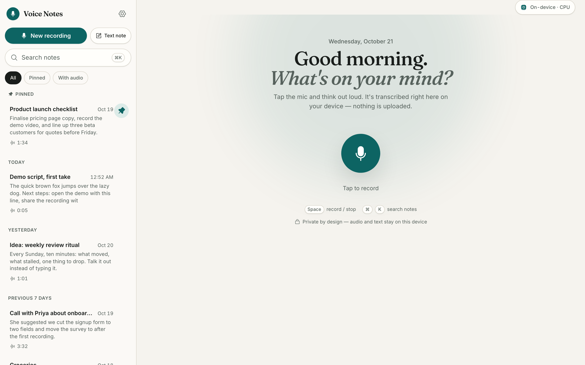
</picture>

</div>

## Features

**Show it, say it, hand it off** ✨ _new_

Narrate your screen, then hand the result to an AI coding agent or a teammate. It's like a
Loom made for agents, but nothing leaves your device.

- **Record with screen.** Share a screen, window or tab alongside the microphone, from the home
  screen or mid-recording. Desktop Chrome, Edge and Firefox.
- **Frames that pick themselves.** A frame is kept when the screen changes _and settles_, so a
  scroll is captured where it lands, not halfway. Press <kbd>S</kbd> to take one yourself.
- **Draw while you talk.** While sharing, press <kbd>D</kbd> (or **Draw**) to freeze the screen
  and mark it up on the spot. The recording keeps going, and Enter takes you back.
- **Mark it up.** Open any frame full screen and draw on it with a pen, highlighter, arrow or
  box. Under the frame you see what you said while it was on screen. Copy the marked-up image,
  or download it.
- **Synced with your voice.** Frames sit on the audio timeline, and the filmstrip highlights the
  frame on screen as the recording plays.
- **Reads the screen.** Text in every frame is read on your device (OCR) in the background.
  Search finds a note by an error message that was only on screen, the viewer's
  **Text on screen** panel lets you copy it, and exports include it for agents.
- **Replay.** Press play and the frames follow your voice, like a video, with the sentence
  being spoken highlighted.
- **Export for agent.** One zip holds `report.md`, written so an agent reads each frame
  together with what you said about it, plus `report.html`, a single offline page anyone can
  open with clickable timestamps, the frames with your marks flattened in, and the audio.
- **Crash-safe like everything else.** Frames are saved as they're taken, recovered with an
  interrupted recording, included in full backups, and deleted (or undone) with their note.

<p align="center">
  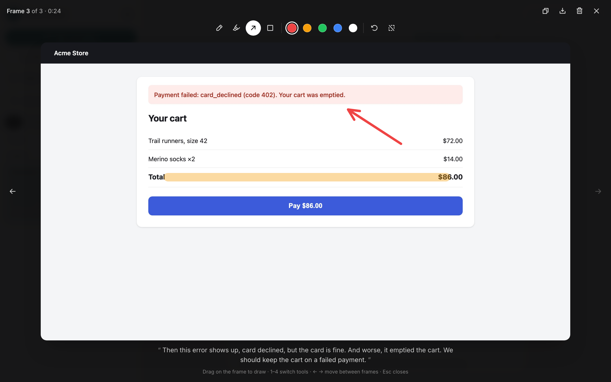
</p>

**Recording that never makes you wait**

- One tap to record, or press <kbd>Space</kbd>. The record button reacts to your voice and a
  live level meter scrolls beside it.
- **Live transcript** while you speak, refined into an accurate final transcript after you stop.
- **Pause, resume and discard.** Maximum length is 20 minutes per recording.
- **Saved the moment you stop.** The note, with its audio, is in your library before
  transcription finishes, and a confirmation card links straight to it.
- **Keeps recording while you browse.** Open another note and a floating control shows the
  timer, pause and stop.
- **Crash-safe.** Audio is written to disk every second. A recording cut off by a closed tab or
  a crash is recovered and transcribed on your next visit.

**A library you can actually find things in**

- Every note in a sidebar (desktop) or under the recorder (phone), grouped by _Today_,
  _Yesterday_, _Previous 7 days_ and by month.
- **Instant search** across titles and text with highlighted matches
  (<kbd>⌘</kbd> <kbd>K</kbd> or <kbd>/</kbd>).
- Filters for **Pinned**, **With audio** and **With screen**. Pin important notes to the top.
- **Search by meaning** (opt-in): also finds notes that say it in other words, with the
  matching passage and a play-from-here time, plus related notes on each note. A 24 MB model
  runs on your device.
- **Tasks:** every checklist item from every note on one page. Tick them off there or in the
  note; it is the same item.
- **Tags** on any note, with suggestions from tags you already use, and a filter by tag.
- **Quick actions** on every note in the list (⋯ or right-click): rename, pin, copy, download
  audio, delete with Undo.
- Status badges show which notes are waiting, transcribing or failed.

**Notes worth keeping**

- A rich editor: headings, bold, italic, underline, strikethrough, highlight, inline code,
  links, bulleted, numbered and **check lists**, and quotes. A formatting bubble appears
  on any text you select, and Markdown shortcuts work as you type.
- **Autosave** with a visible "Saved on this device" indicator.
- **Waveform player** with click-to-seek, ±10 s skip and 1–2× speed.
- **Timestamps view:** click any line of the transcript to hear that moment.
- Copy, share (Web Share API), export to **Markdown** or **plain text**, download the audio,
  re-transcribe, and delete with **Undo**.
- **Text notes** too, for when you'd rather type.

**Bring your own recordings, in your own language**

- **Import audio or video** up to an hour each. Drop files anywhere on the window or use the
  import button. Each file becomes a note, transcribed on your device like a live recording.
- **21 languages**, chosen in Settings: English (the default), Hindi, Spanish, French, German,
  Japanese, Chinese, Arabic and more. Non-English transcripts use the Accurate model.
- **Fast or Accurate.** Fast (Whisper Base) handles live and final transcripts. Accurate
  (Whisper Small) redoes only the final pass, for better results on WebGPU.

**Built to be trusted**

- **On-device speech recognition.** The model downloads once on first use, with progress shown,
  and works offline afterwards.
- **Installable PWA** that works fully offline once loaded.
- **Light and dark themes**, WCAG AA contrast checked in CI, keyboard-first, screen-reader
  labelled, and reduced-motion aware.
- **Marked moments:** press <kbd>M</kbd> (or tap Mark moment) while recording, or Mark in the
  player, to save a point you can jump back to, with an optional label.
- **Record more** onto the end of an existing note. Your edits stay; the new text is added after.
- **Your data, portable:** one-file .zip backup with every note, tag and recording, and restore
  that skips notes already present. Storage usage and delete everything.
- **Model manager:** Settings lists each downloaded model with its size, and removes one on request.

## Screenshots

<table>
  <tr>
    <td width="50%">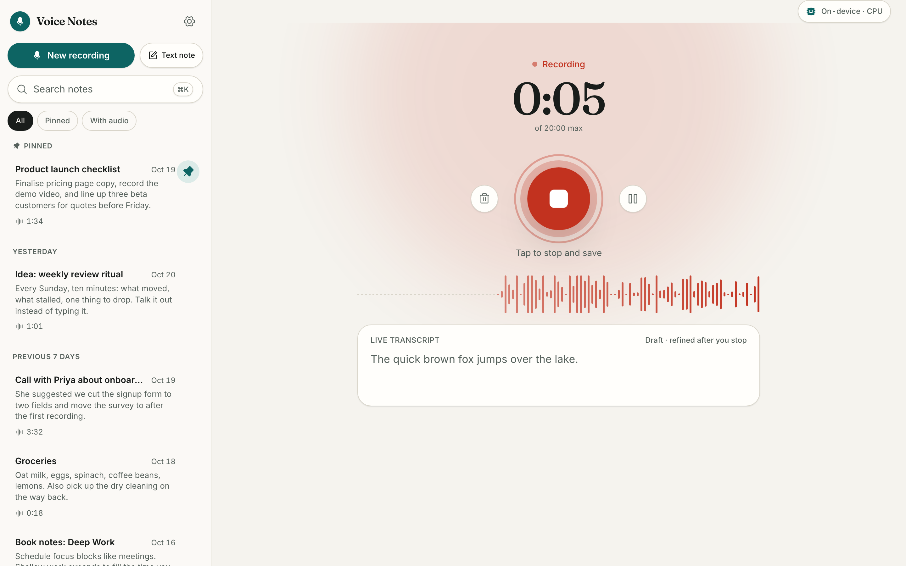</td>
    <td width="50%">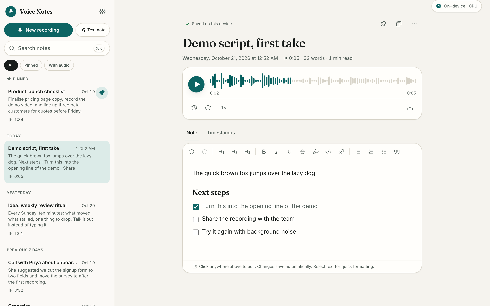</td>
  </tr>
  <tr>
    <td align="center"><sub><b>Recording</b>: live draft transcript, pause and discard</sub></td>
    <td align="center"><sub><b>Note</b>: waveform player, rich editor, timestamps tab</sub></td>
  </tr>
  <tr>
    <td>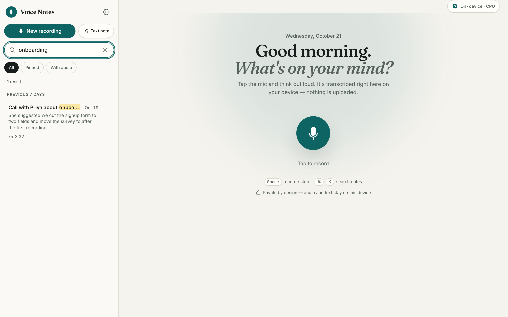</td>
    <td>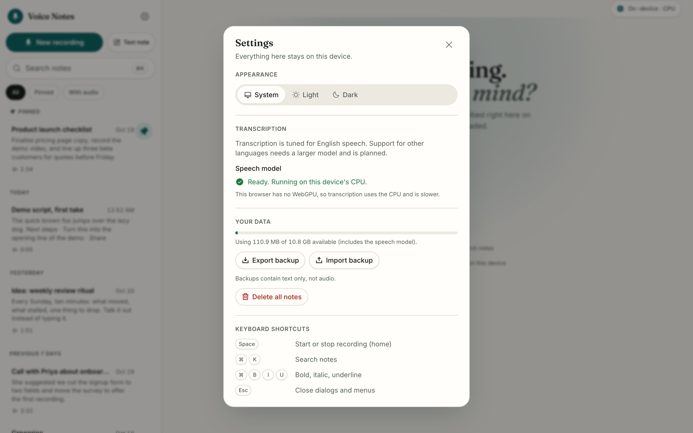</td>
  </tr>
  <tr>
    <td align="center"><sub><b>Search</b>: instant, highlighted, keyboard-driven</sub></td>
    <td align="center"><sub><b>Settings</b>: theme, model, storage, backups</sub></td>
  </tr>
  <tr>
    <td>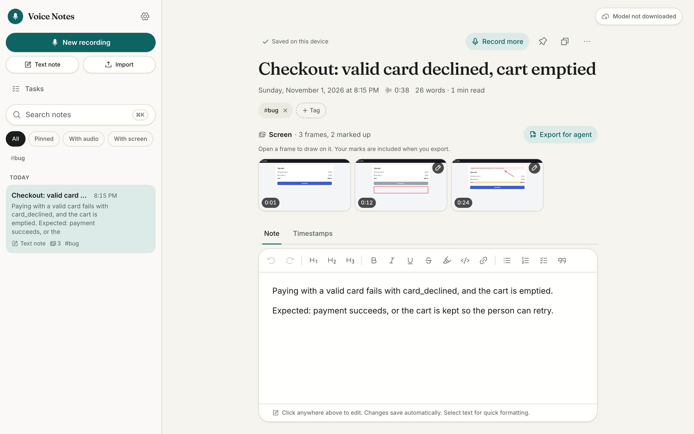</td>
    <td></td>
  </tr>
  <tr>
    <td align="center"><sub><b>Screen notes</b>: filmstrip, marks, export for agent</sub></td>
    <td align="center"><sub><b>Frame viewer</b>: pen, highlighter, arrow, box</sub></td>
  </tr>
  <tr>
    <td>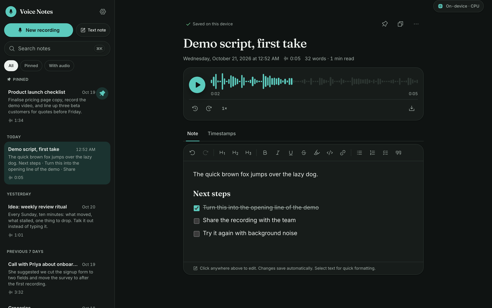</td>
    <td>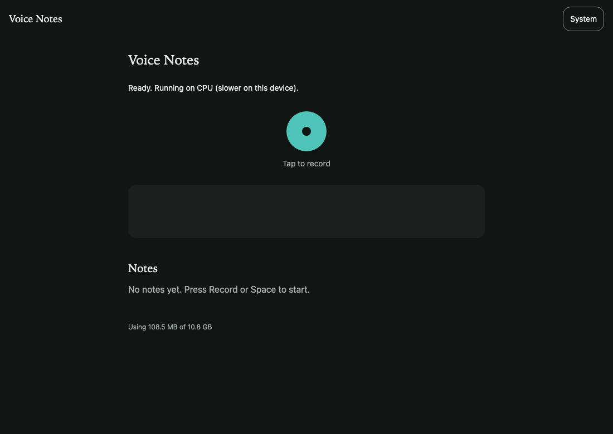</td>
  </tr>
  <tr>
    <td align="center"><sub><b>Dark mode</b>: note page</sub></td>
    <td align="center"><sub><b>Dark mode</b>: home</sub></td>
  </tr>
</table>

<p align="center">
  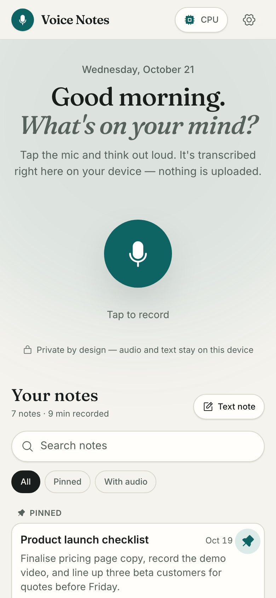
  &nbsp;&nbsp;
  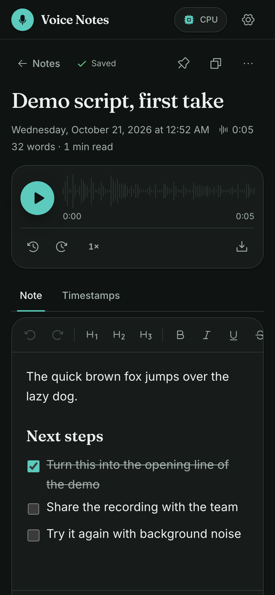
</p>

## How it works

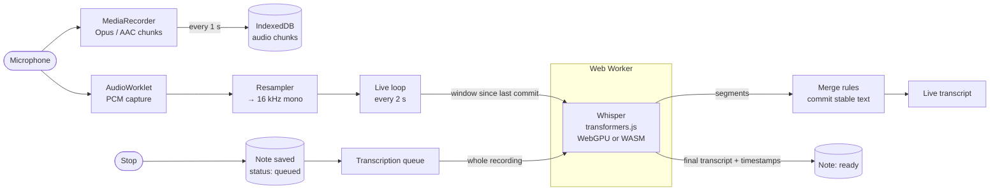

1. **Capture.** The microphone feeds two paths at once. `MediaRecorder` writes compressed audio
   chunks to IndexedDB every second, which is what makes crash recovery possible. An
   `AudioWorklet` collects raw PCM, resampled to the 16 kHz mono that Whisper expects.
2. **Live draft.** Every two seconds the audio since the last committed point goes to the
   worker. The merge rules commit text once it's safely behind a guard band, so words firm up
   without flickering.
3. **Save first, transcribe second.** Stopping writes the note (draft text plus audio)
   immediately with status `queued`. A small queue then runs the accurate full-length pass and
   fills in the transcript, title and timestamps. Unfinished notes resume on the next start,
   decoding the stored audio if the in-memory samples are gone.
4. **Lazy model.** Nothing is downloaded until your first recording, or until you choose
   "Download now" in Settings. Progress is shown in the header chip and inline. Recording
   starts right away, and live text begins once the model is ready.

Inference never runs on the main thread, and `@huggingface/transformers` is only imported by
the workers. CI enforces both.

Search by meaning works the same way on a separate worker. It runs on the CPU, so Whisper keeps
the GPU to itself. See [docs/semantic-search.md](docs/semantic-search.md) for the design.

## Quick start

**Requirements:** Node.js 24.15+ (see `.nvmrc`) and a Chromium-based browser for the best
experience. Recording needs a secure context (`https://` or `localhost`).

```bash
git clone https://github.com/hardikverma22/voice-notes.git
cd voice-notes
npm ci --ignore-scripts
npm run dev
```

Open <http://localhost:5173>, press the mic, and allow microphone access. The first recording
downloads the speech model (about 80 MB on CPU, about 200 MB with WebGPU). Search by meaning and the Accurate model are
separate downloads, and both are opt-in.

> [!NOTE]
> `--ignore-scripts` skips the install script of `onnxruntime-node`, a Node-only transitive
> dependency of transformers.js that downloads a native binary the browser app never uses.

### Scripts

| Script                              | What it does                                                              |
| ----------------------------------- | ------------------------------------------------------------------------- |
| `npm run dev`                       | Development server on port 5173                                           |
| `npm run build`                     | Production build into `dist/`                                             |
| `npm run preview`                   | Serve `dist/` on port 4391 (used by the e2e tests)                        |
| `npm run typecheck`                 | TypeScript for app code and config                                        |
| `npm run lint`                      | ESLint (flat config, React hooks rules)                                   |
| `npm run format` / `format:check`   | Prettier                                                                  |
| `npm run test`                      | Unit tests (Vitest; jsdom and node environments)                          |
| `npm run test:e2e`                  | Generates audio fixtures, then runs Playwright with a fake microphone     |
| `npm run check:bundle`              | Entry-chunk budget, and transformers.js must stay inside the worker       |
| `npm run check:contrast`            | WCAG contrast for every design-token pair, light and dark                 |
| `npm run verify`                    | Everything above except e2e, in order: run this before opening a PR       |
| `node scripts/bench-embeddings.mjs` | Benchmarks search models on synthetic notes (see docs/semantic-search.md) |
| `npm run icons`                     | Regenerates the PWA icons                                                 |

Regenerate the screenshots in this README with:

```bash
SCREENSHOTS=1 npx playwright test screenshots.spec.ts
```

## Architecture

```
src/
├── app/                 Shell: layout + sidebar, router, settings dialog, theme,
│                        recording pill, update prompt, storage estimate
├── design/              tokens.css (colour, type, radius, motion), motion provider,
│   └── components/      Button, Dialog, Menu, Segmented, Select, Toast, ProgressBar, Kbd
├── features/
│   ├── home/            Recorder hero: greeting, record stage, live view, saved card
│   ├── recorder/        RecordingProvider (app-wide mic owner), recorder, AudioWorklet,
│   │                    resampler, PCM buffer, waveform, audio level, decode utilities
│   ├── transcribe/      Worker protocol and client, model store and cache manager,
│   │                    transcription queue, Fast / Accurate settings, live-merge rules
│   ├── import/          Audio and video files turned into notes
│   ├── search/          Chunking, embedding store, indexer, cosine ranking, related notes
│   ├── screen/          Screen capture, scene-change detection, frame viewer and drawing,
│   │                    frame/transcript pairing, agent report (Markdown + HTML) and zip
│   ├── tasks/           Checklist items from every note, for the Tasks page
│   └── notes/           Library (search, groups, filters, tags), note page, Tiptap editor,
│                        audio player, timestamps, marked moments, export, titles
├── lib/                 Formatting, debounce, tag helpers
├── storage/             Dexie schema (v5), note, audio and frame operations, zip backup and restore
├── dev/                 Demo notes, for development builds only
└── workers/
    ├── whisper.worker.ts  Speech recognition (Whisper)
    └── embed.worker.ts    Embeddings for search by meaning and related notes
```

### Key design decisions

| Decision                                            | Why                                                                                                             |
| --------------------------------------------------- | --------------------------------------------------------------------------------------------------------------- |
| Recording lives in an app-level `RecordingProvider` | Navigating between notes never stops the microphone.                                                            |
| Save the note before the final transcription        | Stopping always ends with a saved note. Transcription is retried, never lost.                                   |
| Two capture paths (MediaRecorder + AudioWorklet)    | Compressed audio for storage and playback; exact PCM for Whisper, without decoding twice.                       |
| One worker, one job at a time                       | Final passes jump the queue, and a newer live request replaces a waiting one, so the UI never piles up work.    |
| Model state in a tiny external store                | Header chip, recorder, note page and settings all show the same download progress.                              |
| Motion features lazy-loaded                         | Animation code loads in its own chunk; start-up JavaScript is held under a 170 kB gzip budget (`check:bundle`). |
| Search index is derived data                        | Chunks and vectors can be rebuilt at any time, so they are left out of backups and deleted with their note.     |
| Accurate model only for the final pass              | Live text stays fast on the Fast model. The bigger model runs once, when the note is finalised.                 |
| Hash routing                                        | Works on GitHub Pages and offline with no server rewrites.                                                      |
| Screen frames ride on the recording session         | Frames are saved under the audio session as they're taken, so crash recovery and append work with no new paths. |
| Drawings are vectors, flattened only on export      | Strokes stay editable (undo, clear) and crisp at any size. One SVG path string drives both overlay and export.  |

### Data model

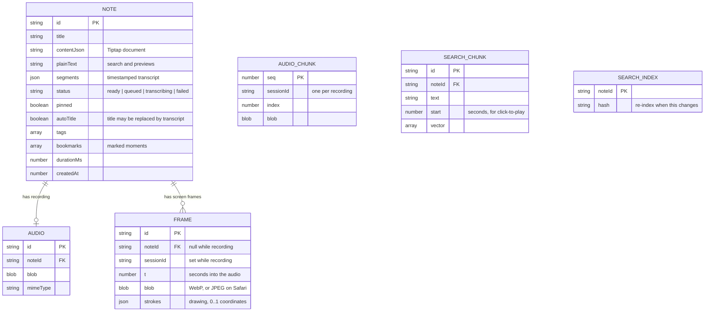

`audioChunks` holds a recording while it's in progress. On stop, the chunks are joined into one
`audio` record in a single transaction. Any session left behind (tab closed, crash) is turned
into a recovered note at the next start.

### Tech stack

| Area    | Choice                                                                                                    |
| ------- | --------------------------------------------------------------------------------------------------------- |
| UI      | React 19, Tailwind CSS 4, Motion, Phosphor icons, Inter + Fraunces                                        |
| Editor  | Tiptap 3 (StarterKit, task lists, highlight, Markdown, bubble menu)                                       |
| Speech  | `whisper-base` (Fast) and `whisper-small` (Accurate) via `@huggingface/transformers` 4 (ONNX Runtime Web) |
| Search  | `Snowflake/snowflake-arctic-embed-xs` embeddings in a worker, brute-force cosine similarity               |
| Backup  | `fflate` for the one-file zip backup                                                                      |
| Storage | IndexedDB through Dexie 4, with live queries                                                              |
| Offline | `vite-plugin-pwa` (Workbox); fonts and app shell are precached                                            |
| Build   | Vite 8 (Rolldown), TypeScript 6                                                                           |
| Quality | Vitest, Playwright, axe-core, ESLint, Prettier                                                            |

### Model details

| Setting         | Value                                                                                    |
| --------------- | ---------------------------------------------------------------------------------------- |
| Model           | `onnx-community/whisper-base`                                                            |
| WebGPU download | fp32 encoder + 4-bit decoder, about 202 MB                                               |
| WASM download   | 8-bit encoder + decoder, about 80 MB                                                     |
| Languages       | 21 in Settings, English by default (non-English uses Accurate)                           |
| Final pass      | 30 s chunks with 5 s stride, timestamped segments                                        |
| Accurate model  | `onnx-community/whisper-small`, fp16 encoder + q4 decoder, about 410 MB, final pass only |

If WebGPU has no adapter or fails to load, the worker falls back to WASM and the header shows
**CPU**. For a smaller download, set `MODEL_ID` in `src/features/transcribe/config.ts` to
`onnx-community/whisper-tiny.en` (about 45 MB on WASM).

## Privacy

What leaves your device:

- **One-time model downloads** from `huggingface.co`, cached by the browser afterwards: the
  speech model (about 80 to 200 MB), and only if you use them, the Accurate speech model
  (about 410 MB) and the search model (about 24 MB).
- **The ONNX runtime** for the model, from `cdn.jsdelivr.net`, also cached afterwards.
- **The screen text reader** (Tesseract, about 5 MB), from `cdn.jsdelivr.net`, only once you
  have a screen recording. It can be turned off in Settings → Screen recording.

That's all. Audio, transcripts and notes are stored in your browser's IndexedDB. There are no
accounts, analytics, telemetry or cloud sync. Clearing site data, or **Settings → Delete all
notes**, removes everything.

## Browser support

| Browser                | Status                                                                                                              |
| ---------------------- | ------------------------------------------------------------------------------------------------------------------- |
| Chrome, Edge (desktop) | Primary target. WebGPU used when available.                                                                         |
| Firefox                | Works. Records WebM or Ogg/Opus, whichever the version supports. Usually transcribes on CPU.                        |
| Safari (macOS, iOS)    | Works. Records MP4/AAC and usually runs on CPU. Add to Home Screen so storage isn't evicted after 7 days of disuse. |

Screen recording needs `getDisplayMedia`: desktop Chrome, Edge, Firefox and Safari. Phones
can't share a screen, so the button is hidden there, but notes with frames still open,
mark up and export on a phone.

## Testing

- **Unit (Vitest):** live-merge rules, resampler, PCM buffer, MIME selection, titles, export
  names, library grouping, search and snippets, task extraction, transcription settings,
  stuck-job detection, storage lifecycle (status, pinning, auto-titles, tags, backups), and
  component tests.
- **End-to-end (Playwright):** a fake microphone plays a generated WAV, covering record, pause,
  discard, Space toggle, recording while browsing, first-run model download with progress,
  final transcription, reload persistence, delete with undo, crash recovery, search, autosave,
  export, and offline use. It also covers file import (and rejecting non-audio), tags and
  filtering, marked moments, record-more, the Tasks page, and search by meaning with related
  notes. Speech fixtures need macOS `say`; those tests skip elsewhere. Screen recording runs
  against Chromium's fake display capture: auto and manual frames, drawing, undo, persistence,
  timeline ticks, and the exported zip's contents.
- **Cross-browser:** `npm run test:e2e:cross` runs the screen-recording, OCR, home and smoke
  specs in Firefox (which can fake a mic and a shared screen), and the home and smoke specs in
  WebKit. Playwright's WebKit can't fake a shared screen or keep Blobs in IndexedDB, so screen
  capture in Safari is covered by its JPEG fallback test rather than end to end. Run
  `npx playwright install firefox webkit` once first.
- **Accessibility:** axe (WCAG 2.0/2.1 AA) on home and note pages in light and dark, plus a
  phone-width layout check. Contrast for every token pair runs in `npm run verify`.

## Deployment

Pushing to `main` deploys to GitHub Pages through
[`.github/workflows/pages.yml`](.github/workflows/pages.yml). The build uses
`PAGES_BASE=/voice-notes/` for the project-site path and runs the bundle check before
publishing. Any static host works: serve `dist/` over HTTPS.

## Roadmap

- [x] Multilingual transcription, with an opt-in "Accurate" mode (Whisper Small)
- [x] Import audio and video files
- [x] Append a new recording to an existing note
- [x] Tags (folders may follow)
- [x] Full backup including audio (zip)
- [x] On-device semantic search across notes, with related notes
- [x] Tasks page collecting checklist items from every note
- [x] Screen recording with marked-up frames, and an export made for AI agents
- [x] Text in frames (on-device OCR), so search finds what was on screen
- [ ] Folders, built on tags
- [ ] Optional end-to-end encrypted sync between your own devices

## Further reading

- [docs/semantic-search.md](docs/semantic-search.md): the search model benchmark and design
- [docs/screen-notes.md](docs/screen-notes.md): how screen frames are chosen, stored, drawn on and exported
- [PRODUCT.md](PRODUCT.md) and [DESIGN.md](DESIGN.md): product and design direction
- [PLAN.md](PLAN.md): the build plan and decision log

## Contributing

Issues and pull requests are welcome. Please run `npm run verify` before opening a PR, and add
or update tests for behaviour changes. UI changes should keep `npm run check:contrast` and the
axe e2e checks green.

## Credits

Inspired by [addyosmani/say](https://github.com/addyosmani/say) (MIT). No code was copied: the
idea of private, on-device dictation comes from it. Speech recognition is
[OpenAI Whisper](https://github.com/openai/whisper), run in the browser by
[Transformers.js](https://github.com/huggingface/transformers.js).

## License

[MIT](LICENSE) © 2026 Hardik Verma
