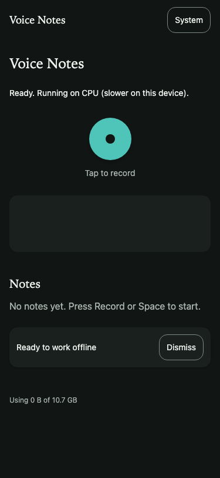

# Voice Notes

A private, offline-first voice notes app. Speak, and Whisper transcribes on your device. Notes, audio, and transcripts stay in your browser.





## Privacy

What leaves your device:

- **The one-time model download** from `huggingface.co` (the Whisper model files, cached by your browser afterwards).
- **The ONNX runtime** for the speech model, loaded from `cdn.jsdelivr.net` (also cached afterwards).

Nothing else is sent anywhere. Audio, transcripts, and notes are stored in your browser's IndexedDB and Cache Storage. There are no accounts, no analytics, and no cloud sync.

## Requirements

- Node.js 24.15 or newer (see `.nvmrc`).
- A modern browser with microphone access. Chrome and Edge are the best supported. Firefox and Safari work but are less tested (see [Browser support](#browser-support)).
- Recording needs a secure context: `https://` or `localhost`.

## Setup

```bash
npm ci
npm run dev          # open http://localhost:5173
```

## Scripts

| Script                            | What it does                                                                 |
| --------------------------------- | ---------------------------------------------------------------------------- |
| `npm run dev`                     | Development server on port 5173                                              |
| `npm run build`                   | Production build into `dist/`                                                |
| `npm run preview`                 | Serve `dist/` on port 4391 (the e2e tests use this)                          |
| `npm run typecheck`               | TypeScript for app code and config                                           |
| `npm run lint`                    | ESLint (flat config)                                                         |
| `npm run format` / `format:check` | Prettier                                                                     |
| `npm run test`                    | Unit tests (Vitest, jsdom and node environments)                             |
| `npm run test:e2e`                | Generates audio fixtures, then runs Playwright in Chromium                   |
| `npm run icons`                   | Regenerates the PWA icons from the token colours                             |
| `npm run check:bundle`            | Enforces the entry-chunk budget and that transformers.js stays in the worker |
| `npm run check:contrast`          | WCAG contrast for every token pair, light and dark                           |
| `npm run verify`                  | Everything above except e2e, in order                                        |

Screenshots: `SCREENSHOTS=1 npx playwright test screenshots.spec.ts` writes into `docs/screenshots/`.

## Architecture

```
src/
  app/            layout, theme, router, update prompt, offline and storage indicators
  design/         tokens.css (all colours, type, space, motion), shared components
  features/
    recorder/     microphone capture, AudioWorklet PCM, resampling, waveform, record button
    transcribe/   worker protocol, Whisper config, worker client, live merge rules, model status
    notes/        note list, note page, Tiptap editor, export, titles
  storage/        Dexie schema, notes and audio operations
  workers/        whisper.worker.ts: the only file that imports transformers.js
```

Data flow: the microphone feeds an AudioWorklet, which produces 16 kHz PCM. The live loop sends the audio since the last committed point to the worker every two seconds, and the merge rules commit stable text. On stop, the whole recording goes to the worker as a final pass. The final transcript, the audio chunks, and the note are then saved to IndexedDB.

The main thread never runs inference. The model loads once per browser profile, and the Cache API keeps it for offline use.

## Models and versions

| Setting         | Value                                        |
| --------------- | -------------------------------------------- |
| Model           | `onnx-community/whisper-base` (multilingual) |
| WebGPU download | fp32 encoder + 4-bit decoder, about 202 MB   |
| WASM download   | 8-bit encoder + decoder, about 80 MB         |
| Runtime         | `@huggingface/transformers` 4.3.1            |
| Framework       | React 19.3.1, Vite 8.3.4, Tailwind CSS 4.3.3 |

Fallback: if WebGPU has no adapter or fails to load, the app uses WASM and says so ("CPU (slower on this device)"). If you want a smaller download, change `MODEL_ID` in `src/features/transcribe/config.ts` to `onnx-community/whisper-tiny.en` (about 45 MB on WASM).

## Browser support

- **Chrome and Edge (desktop):** the primary target. WebGPU is used when available.
- **Firefox:** recording works. Some versions need `audio/ogg` instead of WebM, which the app handles.
- **Safari (macOS and iOS):** recording records MP4, which is handled. Expect the WASM path on most iPhones. Add the app to the Home Screen so the browser keeps its storage. Safari can evict unused site storage after about seven days otherwise.
- Headless Chromium in tests has no WebGPU adapter, so the WASM path is what the tests exercise.

## Testing

- **Unit tests:** pure logic (live merge rules, resampler, PCM buffer, MIME selection, titles, export names), storage (in the node environment, where Blobs round-trip), and component tests.
- **E2E tests:** Playwright in Chromium with a fake microphone that plays a generated WAV. Transcription tests need macOS `say` to make the fixture; they skip elsewhere.
- **Accessibility:** axe checks (WCAG 2.0 and 2.1 AA) on the home and note pages in light and dark, plus reduced-motion and phone-width checks.

## Credits

Inspired by [addyosmani/say](https://github.com/addyosmani/say) (MIT). No code was copied; the flow and the idea of on-device dictation come from it.
