<div align="center">


# Voice Notes

**Think out loud. Get clean notes. Nothing leaves your device.**

A private, offline-first voice notes app for the browser. Whisper runs on your own hardware
(WebGPU, or WebAssembly as a fallback). Recordings, transcripts and notes stay in your
browser's storage.

[**Open the app →**](https://hardikverma22.github.io/voice-notes/)

[](https://github.com/hardikverma22/voice-notes/actions/workflows/pages.yml)
[](LICENSE)


[Features](#features) · [Screenshots](#screenshots) · [How it works](#how-it-works) ·
[Quick start](#quick-start) · [Architecture](#architecture) · [Privacy](#privacy) ·
[Roadmap](#roadmap)

<br />

<picture>
  <source media="(prefers-color-scheme: dark)" srcset="docs/screenshots/home-dark.png" />
  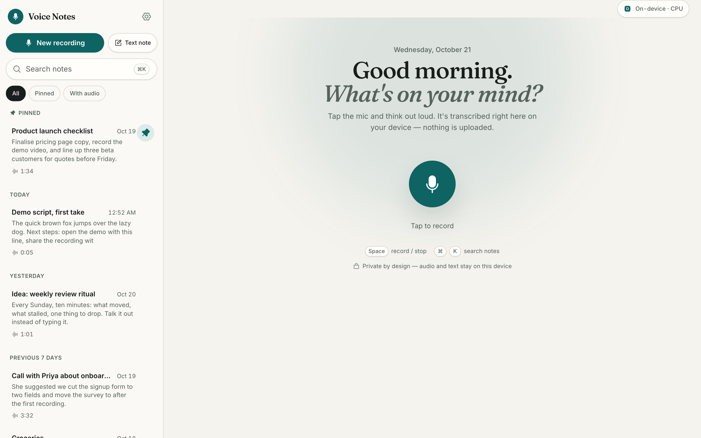
</picture>

</div>

## Features

**Recording that never makes you wait**

- One tap to record, or press <kbd>Space</kbd>. The record button reacts to your voice and a
  live level meter scrolls beside it.
- **Live transcript** while you speak, refined into an accurate final transcript after you stop.
- **Pause, resume and discard.** Maximum length is 20 minutes per recording.
- **Saved the moment you stop.** The note, with its audio, is in your library before
  transcription finishes, and a confirmation card links straight to it.
- **Keeps recording while you browse.** Open another note and a floating control shows the
  timer, pause and stop.
- **Crash-safe.** Audio is written to disk every second. A recording cut off by a closed tab or
  a crash is recovered and transcribed on your next visit.

**A library you can actually find things in**

- Every note in a sidebar (desktop) or under the recorder (phone), grouped by _Today_,
  _Yesterday_, _Previous 7 days_ and by month.
- **Instant search** across titles and text with highlighted matches
  (<kbd>⌘</kbd> <kbd>K</kbd> or <kbd>/</kbd>).
- Filters for **Pinned** and **With audio**. Pin important notes to the top.
- Status badges show which notes are waiting, transcribing or failed.

**Notes worth keeping**

- A rich editor: headings, bold, italic, underline, strikethrough, highlight, inline code,
  links, bulleted, numbered and **check lists**, and quotes. A formatting bubble appears
  on any text you select, and Markdown shortcuts work as you type.
- **Autosave** with a visible "Saved on this device" indicator.
- **Waveform player** with click-to-seek, ±10 s skip and 1–2× speed.
- **Timestamps view:** click any line of the transcript to hear that moment.
- Copy, share (Web Share API), export to **Markdown** or **plain text**, download the audio,
  re-transcribe, and delete with **Undo**.
- **Text notes** too, for when you'd rather type.

**Built to be trusted**

- **On-device speech recognition.** The model downloads once on first use, with progress shown,
  and works offline afterwards.
- **Installable PWA** that works fully offline once loaded.
- **Light and dark themes**, WCAG AA contrast checked in CI, keyboard-first, screen-reader
  labelled, and reduced-motion aware.
- **Your data, portable:** text backup export and import, storage usage, delete everything.

## Screenshots

<table>
  <tr>
    <td width="50%">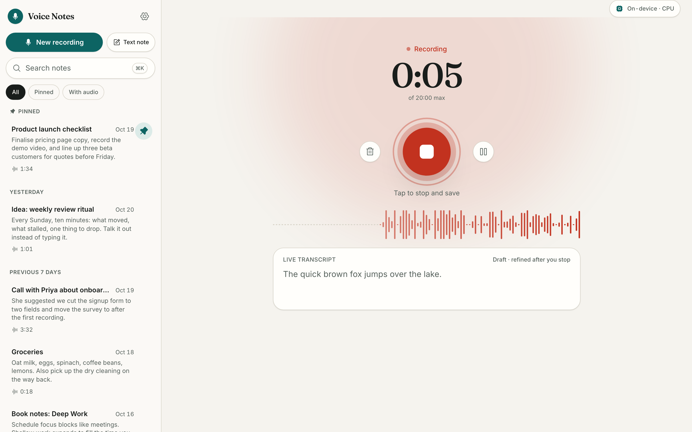</td>
    <td width="50%">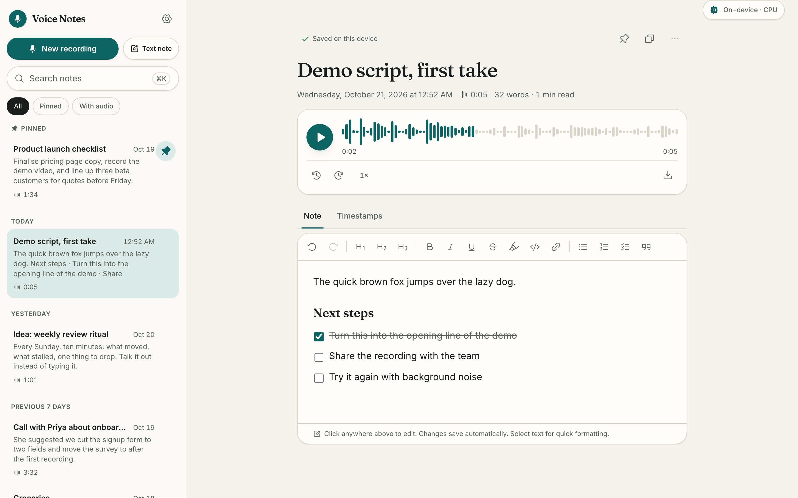</td>
  </tr>
  <tr>
    <td align="center"><sub><b>Recording</b>: live draft transcript, pause and discard</sub></td>
    <td align="center"><sub><b>Note</b>: waveform player, rich editor, timestamps tab</sub></td>
  </tr>
  <tr>
    <td>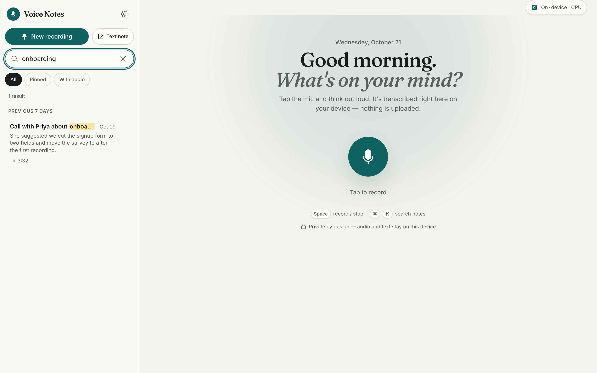</td>
    <td>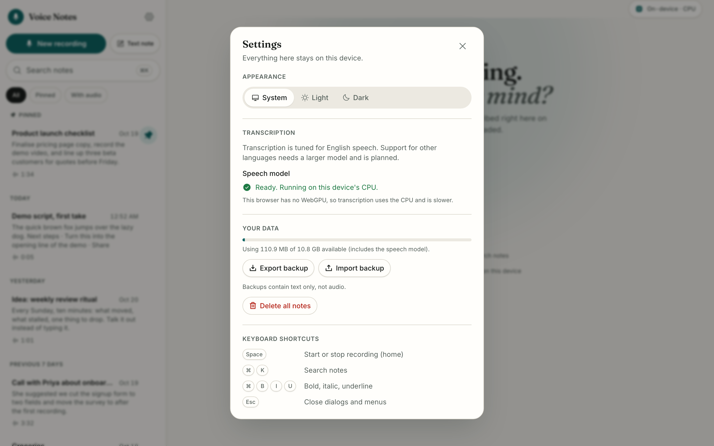</td>
  </tr>
  <tr>
    <td align="center"><sub><b>Search</b>: instant, highlighted, keyboard-driven</sub></td>
    <td align="center"><sub><b>Settings</b>: theme, model, storage, backups</sub></td>
  </tr>
  <tr>
    <td>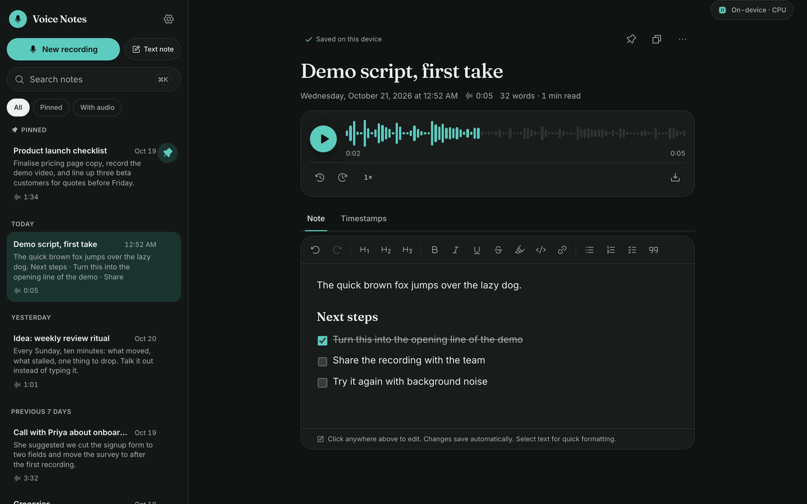</td>
    <td>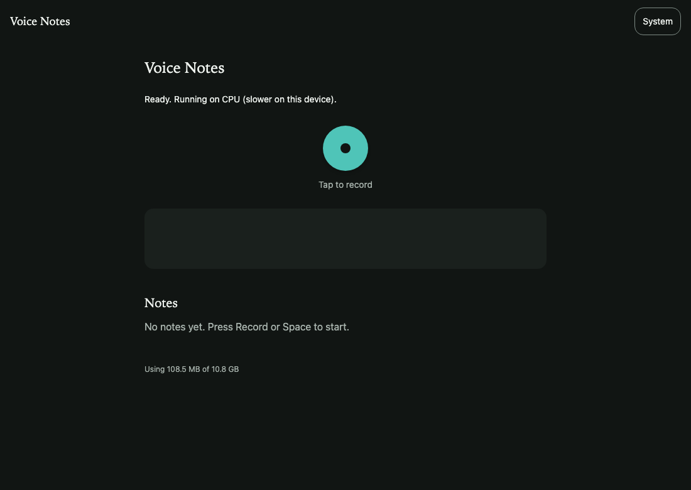</td>
  </tr>
  <tr>
    <td align="center"><sub><b>Dark mode</b>: note page</sub></td>
    <td align="center"><sub><b>Dark mode</b>: home</sub></td>
  </tr>
</table>

<p align="center">
  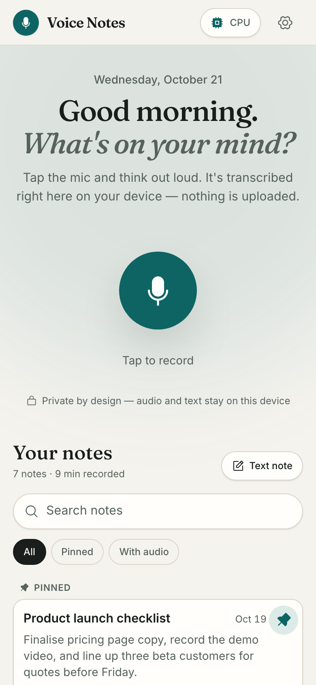
  &nbsp;&nbsp;
  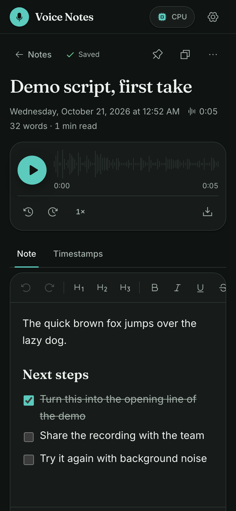
</p>

## How it works

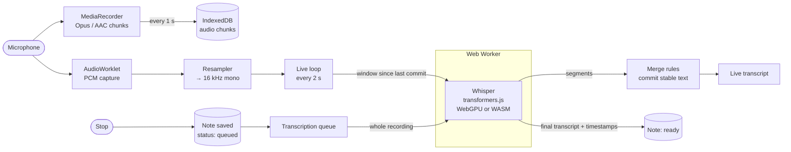

1. **Capture.** The microphone feeds two paths at once. `MediaRecorder` writes compressed audio
   chunks to IndexedDB every second, which is what makes crash recovery possible. An
   `AudioWorklet` collects raw PCM, resampled to the 16 kHz mono that Whisper expects.
2. **Live draft.** Every two seconds the audio since the last committed point goes to the
   worker. The merge rules commit text once it's safely behind a guard band, so words firm up
   without flickering.
3. **Save first, transcribe second.** Stopping writes the note (draft text plus audio)
   immediately with status `queued`. A small queue then runs the accurate full-length pass and
   fills in the transcript, title and timestamps. Unfinished notes resume on the next start,
   decoding the stored audio if the in-memory samples are gone.
4. **Lazy model.** Nothing is downloaded until your first recording, or until you choose
   "Download now" in Settings. Progress is shown in the header chip and inline. Recording
   starts right away, and live text begins once the model is ready.

Inference never runs on the main thread, and `@huggingface/transformers` is only imported by
the worker. CI enforces both.

## Quick start

**Requirements:** Node.js 24.15+ (see `.nvmrc`) and a Chromium-based browser for the best
experience. Recording needs a secure context (`https://` or `localhost`).

```bash
git clone https://github.com/hardikverma22/voice-notes.git
cd voice-notes
npm ci --ignore-scripts
npm run dev
```

Open <http://localhost:5173>, press the mic, and allow microphone access. The first recording
downloads the speech model (about 80 MB on CPU, about 200 MB with WebGPU).

> [!NOTE]
> `--ignore-scripts` skips the install script of `onnxruntime-node`, a Node-only transitive
> dependency of transformers.js that downloads a native binary the browser app never uses.

### Scripts

| Script                            | What it does                                                          |
| --------------------------------- | --------------------------------------------------------------------- |
| `npm run dev`                     | Development server on port 5173                                       |
| `npm run build`                   | Production build into `dist/`                                         |
| `npm run preview`                 | Serve `dist/` on port 4391 (used by the e2e tests)                    |
| `npm run typecheck`               | TypeScript for app code and config                                    |
| `npm run lint`                    | ESLint (flat config, React hooks rules)                               |
| `npm run format` / `format:check` | Prettier                                                              |
| `npm run test`                    | Unit tests (Vitest; jsdom and node environments)                      |
| `npm run test:e2e`                | Generates audio fixtures, then runs Playwright with a fake microphone |
| `npm run check:bundle`            | Entry-chunk budget, and transformers.js must stay inside the worker   |
| `npm run check:contrast`          | WCAG contrast for every design-token pair, light and dark             |
| `npm run verify`                  | Everything above except e2e, in order: run this before opening a PR   |
| `npm run icons`                   | Regenerates the PWA icons                                             |

Regenerate the screenshots in this README with:

```bash
SCREENSHOTS=1 npx playwright test screenshots.spec.ts
```

## Architecture

```
src/
├── app/                 Shell: layout + sidebar, router, settings dialog, theme,
│                        recording pill, update prompt, storage estimate
├── design/              tokens.css (colour, type, radius, motion), motion provider,
│   └── components/      Button, Dialog, Menu, Segmented, Toast, ProgressBar, Kbd
├── features/
│   ├── home/            Recorder hero: greeting, record stage, live view, saved card
│   ├── recorder/        RecordingProvider (app-wide mic owner), recorder, AudioWorklet,
│   │                    resampler, PCM buffer, waveform, audio level, decode utilities
│   ├── transcribe/      Worker protocol and client, model store, transcription queue,
│   │                    live-merge rules, live transcript, model indicators
│   └── notes/           Library (search, groups, filters), note page, Tiptap editor,
│                        audio player, timestamps view, export, titles
├── storage/             Dexie schema (v2) and note / audio operations
└── workers/
    └── whisper.worker.ts  The only importer of @huggingface/transformers
```

### Key design decisions

| Decision                                            | Why                                                                                                          |
| --------------------------------------------------- | ------------------------------------------------------------------------------------------------------------ |
| Recording lives in an app-level `RecordingProvider` | Navigating between notes never stops the microphone.                                                         |
| Save the note before the final transcription        | Stopping always ends with a saved note. Transcription is retried, never lost.                                |
| Two capture paths (MediaRecorder + AudioWorklet)    | Compressed audio for storage and playback; exact PCM for Whisper, without decoding twice.                    |
| One worker, one job at a time                       | Final passes jump the queue, and a newer live request replaces a waiting one, so the UI never piles up work. |
| Model state in a tiny external store                | Header chip, recorder, note page and settings all show the same download progress.                           |
| Motion features lazy-loaded                         | Animation code loads in its own chunk; the entry bundle stays around 133 kB gzip.                            |
| Hash routing                                        | Works on GitHub Pages and offline with no server rewrites.                                                   |

### Data model

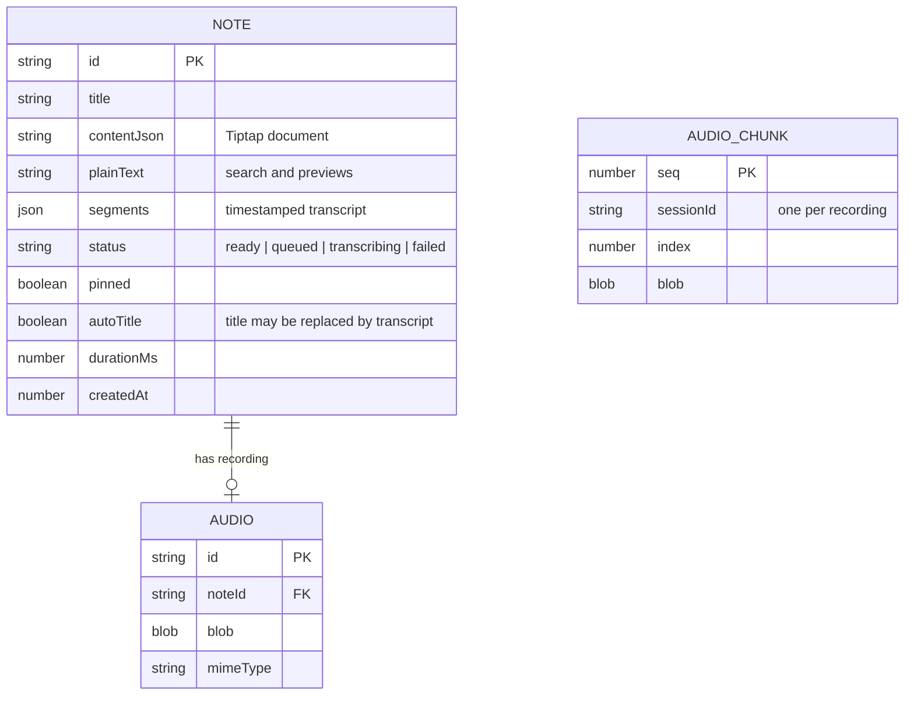

`audioChunks` holds a recording while it's in progress. On stop, the chunks are joined into one
`audio` record in a single transaction. Any session left behind (tab closed, crash) is turned
into a recovered note at the next start.

### Tech stack

| Area    | Choice                                                                             |
| ------- | ---------------------------------------------------------------------------------- |
| UI      | React 19, Tailwind CSS 4, Motion, Phosphor icons, Inter + Fraunces                 |
| Editor  | Tiptap 3 (StarterKit, task lists, highlight, Markdown, bubble menu)                |
| Speech  | `onnx-community/whisper-base` via `@huggingface/transformers` 4 (ONNX Runtime Web) |
| Storage | IndexedDB through Dexie 4, with live queries                                       |
| Offline | `vite-plugin-pwa` (Workbox); fonts and app shell are precached                     |
| Build   | Vite 8 (Rolldown), TypeScript 6                                                    |
| Quality | Vitest, Playwright, axe-core, ESLint, Prettier                                     |

### Model details

| Setting         | Value                                                     |
| --------------- | --------------------------------------------------------- |
| Model           | `onnx-community/whisper-base`                             |
| WebGPU download | fp32 encoder + 4-bit decoder, about 202 MB                |
| WASM download   | 8-bit encoder + decoder, about 80 MB                      |
| Language        | English (Whisper Base isn't reliable for other languages) |
| Final pass      | 30 s chunks with 5 s stride, timestamped segments         |

If WebGPU has no adapter or fails to load, the worker falls back to WASM and the header shows
**CPU**. For a smaller download, set `MODEL_ID` in `src/features/transcribe/config.ts` to
`onnx-community/whisper-tiny.en` (about 45 MB on WASM).

## Privacy

What leaves your device:

- **The one-time model download** from `huggingface.co`, cached by the browser afterwards.
- **The ONNX runtime** for the model, from `cdn.jsdelivr.net`, also cached afterwards.

That's all. Audio, transcripts and notes are stored in your browser's IndexedDB. There are no
accounts, analytics, telemetry or cloud sync. Clearing site data, or **Settings → Delete all
notes**, removes everything.

## Browser support

| Browser                | Status                                                                                                              |
| ---------------------- | ------------------------------------------------------------------------------------------------------------------- |
| Chrome, Edge (desktop) | Primary target. WebGPU used when available.                                                                         |
| Firefox                | Works. Records WebM or Ogg/Opus, whichever the version supports. Usually transcribes on CPU.                        |
| Safari (macOS, iOS)    | Works. Records MP4/AAC and usually runs on CPU. Add to Home Screen so storage isn't evicted after 7 days of disuse. |

## Testing

- **Unit (Vitest):** live-merge rules, resampler, PCM buffer, MIME selection, titles, export
  names, library grouping, search and snippets, storage lifecycle (status, pinning,
  auto-titles, backups), and component tests.
- **End-to-end (Playwright):** a fake microphone plays a generated WAV, covering record, pause,
  discard, Space toggle, recording while browsing, first-run model download with progress,
  final transcription, reload persistence, delete with undo, crash recovery, search, autosave,
  export, and offline use. Speech fixtures need macOS `say`; those tests skip elsewhere.
- **Accessibility:** axe (WCAG 2.0/2.1 AA) on home and note pages in light and dark, plus a
  phone-width layout check. Contrast for every token pair runs in `npm run verify`.

## Deployment

Pushing to `main` deploys to GitHub Pages through
[`.github/workflows/pages.yml`](.github/workflows/pages.yml). The build uses
`PAGES_BASE=/voice-notes/` for the project-site path and runs the bundle check before
publishing. Any static host works: serve `dist/` over HTTPS.

## Roadmap

- [ ] Multilingual transcription with a larger model (for example Whisper Small) as an opt-in
      "Accurate" mode
- [ ] Append a new recording to an existing note
- [ ] Tags and folders
- [ ] Full backup including audio (zip)
- [ ] Optional end-to-end encrypted sync between your own devices

## Contributing

Issues and pull requests are welcome. Please run `npm run verify` before opening a PR, and add
or update tests for behaviour changes. UI changes should keep `npm run check:contrast` and the
axe e2e checks green.

## Credits

Inspired by [addyosmani/say](https://github.com/addyosmani/say) (MIT). No code was copied: the
idea of private, on-device dictation comes from it. Speech recognition is
[OpenAI Whisper](https://github.com/openai/whisper), run in the browser by
[Transformers.js](https://github.com/huggingface/transformers.js).

## License

[MIT](LICENSE) © 2026 Hardik Verma
