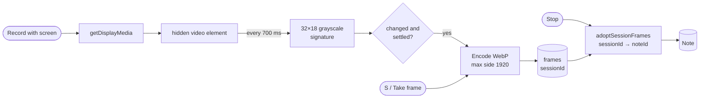

# Screen notes

Record your screen while you talk, mark up the frames, and hand the result to an AI agent or
a teammate. This page covers how it works and why it's built that way.

## The flow



The screen share rides on an ordinary voice recording. The microphone pipeline (live
transcript, crash-safe chunks, transcription queue) is unchanged. Frames are stored under the
recording's session id as they're taken, and move onto the note when it is saved:

| Event                         | Frames                                                         |
| ----------------------------- | -------------------------------------------------------------- |
| Stop                          | `adoptSessionFrames(session, note)`                            |
| Record more (append)          | Same, with times shifted by the existing audio's length        |
| Discard                       | `discardSessionFrames(session)`                                |
| Tab closed or crash           | Recovery adopts them onto the recovered note on the next visit |
| Mic fails after screen picked | The share stops and its frames are discarded                   |

## Choosing frames (`sceneChange.ts`)

Each sample is drawn into a 32×18 canvas and turned into a luma signature (576 bytes). A
frame is kept when all of these hold:

1. **Changed:** the mean difference from the last _kept_ frame is above 4.5%. A blinking
   cursor or a ticking clock stays below that.
2. **Settled:** the difference from the _previous sample_ is below 1.2%, so the screen has
   stopped moving. Scrolls, transitions and loading spinners are captured where they land,
   not halfway.
3. **Spaced:** at least 2.5 s since the last kept frame.

While the recording is paused, no frames are taken. A frame taken by hand (<kbd>S</kbd>)
becomes the new reference, so the same picture isn't also kept automatically.

The logic is a pure function, `observe(state, sample, now)`, unit-tested without a browser.

## Drawing (`annotation.ts`)

Strokes are stored as vectors in 0..1 coordinates of the frame: `{ tool, color, points }`.
`strokePath()` turns one into an SVG path string, which is used twice:

- on screen, as `<path d>` in an SVG laid over the image (`viewBox` = the frame's pixel size);
- on export, as `new Path2D(d)` on a canvas, so the flattened image matches what was drawn.

Pen and highlighter strokes are smoothed with quadratic curves through the sample midpoints
and thinned as they're saved. Line widths scale with the frame width, so a mark looks the
same in a thumbnail, full screen, or the exported image.

## Pairing speech with frames (`timeline.ts`)

Each frame gets the transcript segments from 1.5 s before it until 1.5 s before the next
frame. People tend to say "now I open settings" just before the screen changes. Speech
before the first frame goes to the first frame, so nothing said is dropped. The viewer and
the export use the same function.

## Reading the screen (`ocr.ts`, `ocrQueue.ts`)

After a recording is saved, a background queue reads the text in each frame with Tesseract
(English), one frame at a time, and pauses while Whisper works. Words below 55% confidence
are dropped, and lines that are mostly symbols (icons read as characters) are filtered out.
The text is stored on the frame (`text`: undefined while unread, `''` when there is none), and
a note-level `screenText` rollup feeds library search. A match that is only on screen shows
an **On screen** badge in the list.

The reader loads on first use only, in its own chunk, so start-up JavaScript is unchanged. If
it can't load (offline before its first download), the queue retries later. A frame that
fails twice is stored as having no text, so it never blocks the rest.

## The export bundle

```
checkout-bug-2026-11-01.zip
├── report.md        for agents: notes, walkthrough (frame + what was said), transcript
├── report.html      for people: one offline page, images and audio inlined, timestamps seek
├── frames/
│   ├── 01-0m01s.webp
│   └── 02-0m12s.webp   drawings flattened in
└── audio.webm
```

Each frame in `report.md` also carries its **Text on screen** in a fenced block. The fence is
always longer than any backtick run in the text, so code on screen can't break out of it.
`report.md` starts with a short HTML comment telling an agent how to read it. It says that
frames and the speech under them belong together, that the person's own notes take
priority, and what the coloured marks mean. Everything a person wrote is escaped in
`report.html`. A note exported before its final transcript is ready says so at the top. The
zip code (fflate) loads only when you export.

## Video export (`videoPlan.ts`, `renderVideo.ts`)

The video is a slideshow that follows the voice. `planScenes` cuts the timeline wherever the
frame on screen or the caption changes (frames switch with the same 1.5 s lead as replay,
captions stay up 1.5 s after their segment). Each scene is drawn once on a 1920×1080 canvas
(frame letterboxed, marks flattened, caption at the bottom, title banner for the first 3 s)
and encoded with WebCodecs through mediabunny. Scenes are capped at 1 s so players seek well.
Because only changes are encoded, a minute of recording renders in seconds.

Codecs are picked by what the browser can encode: H.264 then VP9 then AV1 for video, AAC then
Opus for audio, in an MP4. Browsers without `VideoEncoder` get a clear message. The video
code loads only when you export.

## Storage and privacy

Frames are WebP (JPEG where the browser can't encode WebP) at most 1920 px on the long side:
typically 60 to 200 kB each. They live in IndexedDB next to the audio. They are included in
full backups (manifest version 3), deleted with their note, and restored with Undo. Nothing is
uploaded.
